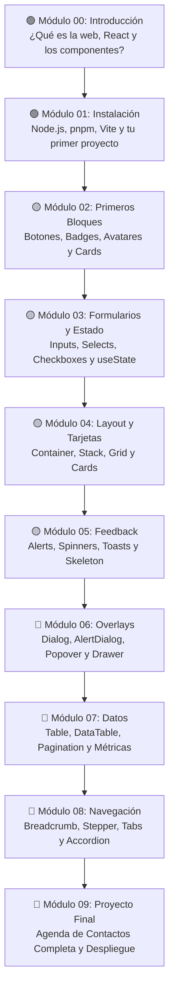

# 📚 Instructivo @alcspower/ui

> Guía paso a paso para aprender a construir interfaces web modernas con React y `@alcspower/ui`, diseñada especialmente para personas sin experiencia previa en programación.
> 
> *Step-by-step guide to building modern web user interfaces with React and `@alcspower/ui`, specifically crafted for complete beginners.*

---

## 🌐 Selecciona tu idioma / Choose your language

| 🇪🇸 Español (Recomendado) | 🇺🇸 English |
| :--- | :--- |
| **[Ir al instructivo en Español](es/README.md)** | **[Go to English Guide (Coming soon)](en/README.md)** |
| Explicaciones pedagógicas desde cero, analogías de la vida real y proyectos prácticos paso a paso. | Beginner-friendly explanations from scratch, real-world analogies, and hands-on projects. |

---

> [!NOTE]
> **¿Nunca has escrito una sola línea de código?**  
> ¡No te preocupes! Este instructivo fue escrito asumiendo que partes desde cero absoluto. No necesitas saber matemáticas complejas, ni haber usado una terminal antes. Te guiaremos paso a paso con paciencia, ejemplos claros y analogías cotidianas.

---

## 🗺️ Mapa de Ruta del Aprendizaje / Learning Roadmap

---

## 📖 Módulos Disponibles / Available Modules

| # | Módulo | Descripción | Dificultad | Tiempo Est. | Enlaces |
| :---: | :--- | :--- | :---: | :---: | :---: |
| **00** | **Introducción Conceptual** | Analogías del mundo real, qué es React, LEGOs digitales y glosario básico. | 🟢 Fácil | ~20 min | [🇪🇸 Leer](es/00-introduccion.md) \| [🇺🇸 Read](en/00-introduction.md) |
| **01** | **Instalación y Entorno** | Instalación de Node.js, pnpm, creación de proyecto con Vite y configuración del paquete. | 🟢 Fácil | ~30 min | [🇪🇸 Leer](es/01-instalacion.md) \| [🇺🇸 Read](en/01-installation.md) |
| **02** | **Tus Primeros Componentes** | `Button`, `Badge`, `Avatar` y `Card`. Ensambla tu primera tarjeta de perfil. | 🟡 Medio | ~45 min | [🇪🇸 Leer](es/02-primer-componente.md) \| [🇺🇸 Read](en/02-first-component.md) |
| **03** | **Interactividad y Formularios** | `Input`, `Label`, `Field`, `Select`, `Checkbox`, `Switch` y el concepto de `useState`. | 🟡 Medio | ~60 min | [🇪🇸 Leer](es/03-formularios.md) \| [🇺🇸 Read](en/03-forms.md) |
| **04** | **Layout y Tarjetas** | `Container`, `Stack`, `Grid` y tarjetas con diseño responsivo. | 🟡 Medio | ~45 min | [🇪🇸 Leer](es/04-layout-y-cards.md) \| [🇺🇸 Read](en/04-layout-and-cards.md) |
| **05** | **Feedback y Notificaciones** | `Alert`, `Spinner`, `Toast` / `Toaster`, `Skeleton`, `EmptyState` y `LoadingOverlay`. | 🟡 Medio | ~50 min | [🇪🇸 Leer](es/05-feedback.md) \| [🇺🇸 Read](en/05-feedback.md) |
| **06** | **Overlays y Diálogos** | `Dialog`, `AlertDialog`, `Popover`, `Sheet`, `Drawer`, `Tooltip` y `DropdownMenu`. | 🔴 Avanzado | ~60 min | [🇪🇸 Leer](es/06-overlays.md) \| [🇺🇸 Read](en/06-overlays.md) |
| **07** | **Visualización de Datos** | `Table`, `DataTable` con TanStack Table, `Pagination`, `Sparkline`, `Gauge` y `Chart`. | 🔴 Avanzado | ~75 min | [🇪🇸 Leer](es/07-datos.md) \| [🇺🇸 Read](en/07-data.md) |
| **08** | **Navegación y Estructura** | `Breadcrumb`, `Stepper`, `Tabs` y `Accordion`. Organización de flujos y vistas. | 🔴 Avanzado | ~50 min | [🇪🇸 Leer](es/08-navegacion.md) \| [🇺🇸 Read](en/08-navigation.md) |
| **09** | **Proyecto Final: Contact Book Pro** | Integra todo en una aplicación funcional completa con persistencia local y temas. | 🚀 Proyecto | ~90 min | [🇪🇸 Leer](es/09-proyecto-final.md) \| [🇺🇸 Read](en/09-final-project.md) |

---

## 🛠️ Stack Tecnológico

La biblioteca `@alcspower/ui` y los proyectos de este instructivo están construidos sobre las herramientas estándar de la industria:

- **[React 19](https://react.dev/)**: La biblioteca más popular del mundo para crear interfaces de usuario interactivas mediante componentes reutilizables.
- **[TypeScript](https://www.typescriptlang.org/)**: Un superconjunto de JavaScript que añade tipos de datos, detectando errores tipográficos y de lógica antes de que ejecutes el código.
- **[Tailwind CSS v4](https://tailwindcss.com/)**: Un motor de diseño basado en clases utilitarias de alto rendimiento para dar estilo a los elementos.
- **`@alcspower/ui`**: Sistema de diseño y biblioteca oficial de componentes accesibles, accesibles por teclado y con soporte para modo oscuro preconfigurado.
- **[Vite](https://vitejs.dev/)**: Entorno de desarrollo ultra rápido para compilar y servir aplicaciones modernas en milisegundos.

---

## 🤝 Soporte y Ayuda

Si te quedas atascado en algún paso:
1. Revisa la sección **"¿Qué puede salir mal?"** al final de cada capítulo.
2. Compara tu código con los snippets completos incluidos en cada ejercicio.
3. Consulta la documentación técnica de componentes en `docs/components/`.
