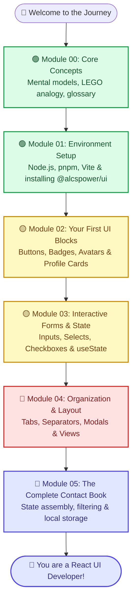

# 🚀 Welcome to the Modern Web with React & @alcspower/ui

> **A friendly, complete, zero-to-hero interactive guide to building beautiful web applications without any prior programming knowledge.**

---

## 📚 What You'll Learn in This Course

Welcome! If you have never written a single line of code in your life, or if you have previously tried and felt overwhelmed by technical jargon, you are in the exact right place.

In this guide, you will learn:
- 💡 **How the web works**: The relationship between HTML, CSS, JavaScript, and modern frameworks.
- 🧱 **Component-Driven Development**: How to think like a UI engineer and assemble complex interfaces from small, reusable parts.
- 🎨 **Design Systems in Practice**: How professional teams use `@alcspower/ui` to build accessible, consistent, and beautiful interfaces at scale.
- 🛠️ **Modern Developer Tooling**: How to use Node.js, pnpm, Vite, TypeScript, and VS Code with confidence.
- ⚡ **Interactive State Management**: How to use React's `useState` hook to make applications respond dynamically to user clicks, typing, and selections.
- 🗃️ **Real-world Application Architecture**: How to build **Contact Book Pro**, an interactive contacts management system with search, filtering, status badges, profile modals, and responsive layouts.

---

## 👋 A Warm Welcome From Your Fellow Builders

Have you ever opened a web browser, clicked a button, watched a sleek card pop up with smooth animations, and wondered: *"How on earth does someone actually build this?"* 

Or maybe you've tried looking up programming tutorials in the past, only to be hit with an overwhelming wall of incomprehensible computer science jargon, mathematical equations, and cryptic terminal commands that made you feel like you were trying to decipher an ancient dialect?

If that sounds familiar, take a deep breath, grab your favorite warm beverage, and relax: **you are in the right place.**

This learning guide was created with one single, unwavering premise: **anyone can learn to build modern user interfaces.** You do not need a degree in Computer Science. You do not need to be a math genius. You do not need any previous experience writing code or using the command prompt.

We are going to start together from absolute ground zero. We will treat every line of code like a clear, logical thought, use everyday real-world analogies (like cooking recipes and LEGO bricks), and assemble everything step-by-step.

```
+-------------------------------------------------------------------------+
|                                                                         |
|   "The secret to learning how to code is not having special talent.     |
|    It is simply having the curiosity to explore, the patience to read   |
|    error messages calmly, and a willingness to build things piece       |
|    by piece."                                                           |
|                                                                         |
+-------------------------------------------------------------------------+
```

---

## 📱 What You Will Build: "Contact Book Pro"

Rather than working through boring, detached exercises that you'll forget by tomorrow, every single lesson in this guide contributes to building a real, fully-functional web application: **Contact Book Pro** (a modern personal & professional contacts manager).

Here is an architectural preview of what your finished application will look like:

```
+-------------------------------------------------------------------------+
|  👥 Contact Book Pro                      [ 🔍 Search contacts... ]  🌙 |
+-------------------------------------------------------------------------+
|  [ All (12) ]  [ Work (5) ]  [ Friends (4) ]  [ Family (3) ]  [+ New]   |
+-------------------------------------------------------------------------+
|                                                                         |
|  +---------------------------+       +---------------------------+      |
|  | [Avatar]  Sarah Jenkins   |       | [Avatar]  Marcus Vance    |      |
|  |           Lead Designer   |       |           DevOps Engineer |      |
|  |                           |       |                           |      |
|  | [Badge: Work] [Badge: Active]     | [Badge: Work] [Badge: Busy]      |
|  | ------------------------- |       | ------------------------- |      |
|  | 📧 sarah.j@company.com    |       | 📧 marcus.v@company.com   |      |
|  | 📞 +1 (555) 019-2834      |       | 📞 +1 (555) 018-9921      |      |
|  |                           |       |                           |      |
|  | [⭐ Favorite] [View More]  |       | [⭐ Favorite] [View More]  |      |
|  +---------------------------+       +---------------------------+      |
|                                                                         |
|  +---------------------------+       +---------------------------+      |
|  | [Avatar]  Elena Rostova   |       | [Avatar]  David Chen      |      |
|  |           Sister          |       |           College Friend  |      |
|  |                           |       |                           |      |
|  | [Badge: Family] [Badge: VIP]      | [Badge: Friends] [Badge: Away]   |
|  | ------------------------- |       | ------------------------- |      |
|  | 📧 elena.r@personal.net   |       | 📧 david.c@personal.net   |      |
|  | 📞 +1 (555) 012-7744      |       | 📞 +1 (555) 014-3311      |      |
|  |                           |       |                           |      |
|  | [⭐ Favorite] [View More]  |       | [⭐ Favorite] [View More]  |      |
|  +---------------------------+       +---------------------------+      |
|                                                                         |
+-------------------------------------------------------------------------+
```

Here is what your finished application will be able to do:
- 👥 **Browse Contacts**: Explore a responsive grid of contact cards with clean typography and spacing.
- 🔍 **Real-time Search & Filter**: Instantly filter contacts by category (Work, Family, Friends) and search by first or last name.
- ➕ **Add New Contacts Form**: A clean, accessible form featuring real-time input validation, category selection, and toggle switches.
- ⭐ **Instant Favorites**: Toggle favorite contacts on the fly with animated switches and visual star badges.
- 👤 **Custom Avatars & Fallbacks**: Display high-resolution user photos with graceful initials fallback when no photo is provided.
- 🎨 **Light & Dark Themes**: Toggle seamlessly between crisp daylight styling and deep obsidian dark mode.
- 💾 **Local Persistence**: Save contacts automatically in the browser so your data stays right there when you refresh the page.

---

## 🗺️ Visual Learning Roadmap

Follow this structured path. Each module builds gently on the lessons learned in the previous one:



---

## 📖 Detailed Module Syllabus & Learning Outcomes

Here is a comprehensive breakdown of each module's curriculum and milestones:

### 🟢 Module 00: Conceptual Introduction
- **Mental Models**: Understanding code as everyday cooking recipes.
- **The LEGO Analogy**: How web pages are constructed from reusable building blocks called components.
- **Why React?**: The story of traditional web development vs. modern reactive rendering.
- **Why `@alcspower/ui`?**: The power of having a pre-built, accessible, styled UI kit ready on day one.
- **TypeScript Demystified**: How typing catches bugs while you type instead of when your users click buttons.
- **Beginner Glossary**: 10 essential terms explained without complicated academic jargon.
- **Milestone**: Complete confidence in the vocabulary and mental models of the modern web.
- 🔗 [Read Module 00: Conceptual Introduction](00-introduction.md)

### 🟢 Module 01: Environment Setup & Your First Project
- **Prerequisites**: Installing Node.js (v20+) and enabling pnpm.
- **Scaffolding**: Creating a new Vite project using the React + TypeScript template.
- **Package Configuration**: Configuring `.npmrc` to access `@alcspower/ui` on GitHub Packages.
- **Installing Dependencies**: Adding `@alcspower/ui` and `lucide-react` icons.
- **Styles Integration**: Importing `@alcspower/ui/styles.css` into `src/main.tsx`.
- **First Visual Test**: Replacing the starter code with an interactive `@alcspower/ui` Button.
- **Troubleshooting Guide**: Solutions for token authorization errors, Node versions, and CSS missing styles.
- **Milestone**: A working, running local development server displaying your first styled component.
- 🔗 [Read Module 01: Installation Guide](01-installation.md)

### 🟡 Module 02: Your First UI Building Blocks
- **The Button**: Variants (`primary`, `secondary`, `outline`, `ghost`, `destructive`, `link`), sizes (`sm`, `md`, `lg`), icons, and loading spinners (`isLoading`, `loadingText`).
- **The Badge**: Statuses, tag indicators, and color variants (`primary`, `secondary`, `success`, `warning`, `destructive`, `info`, `outline`).
- **The Avatar**: Image rendering, alt text for accessibility, and automatic fallback initials with `AvatarFallback`.
- **The Card Suite**: `Card`, `CardHeader`, `CardTitle`, `CardDescription`, `CardContent`, and `CardFooter`.
- **Hands-on Mini Project**: Assembling a complete, professional Contact Profile Card from scratch.
- **Milestone**: Mastering static layout composition with cards, avatars, badges, and action buttons.
- 🔗 [Read Module 02: First Components](02-first-component.md)

### 🟡 Module 03: Interactive Forms & React State
- **The Erasable Whiteboard Analogy**: How React remembers user interactions using `useState`.
- **Controlled Inputs**: Binding text fields to React state with `value` and `onChange`.
- **Input Enhancements**: Error feedback (`hasError`), success states (`hasSuccess`), and icons (`leftElement`, `rightElement`).
- **Accessibility with Label & Field**: Grouping labels, helper text, and inputs with semantic structure.
- **Dropdown Menus (`Select`)**: Composing `SelectTrigger`, `SelectValue`, `SelectContent`, and `SelectItem`.
- **Booleans with Checkbox & Switch**: When to use a standard checkbox vs. a tactile switch toggle.
- **Hands-on Mini Project**: Building an interactive "Add Contact" form with live validation and submission handling.
- **Milestone**: The ability to capture, validate, and store user input in interactive components.
- 🔗 [Read Module 03: Forms & State](03-forms.md)

### 🔴 Module 04: Organization, Layouts & Modals
- **Tabs**: Switching between views (All Contacts, Work, Personal, Favorites) with `TabsList`, `TabsTrigger`, and `TabsContent`.
- **Separators**: Creating visual hierarchy and breathing room using horizontal and vertical `Separator`.
- **Modals & Dialogs**: Displaying confirmation popups and detailed contact inspector panels.
- **Responsive Grids**: Arranging cards in 1-column mobile layouts and 3-column desktop grids using Tailwind classes.
- **Milestone**: Complex, multi-screen navigation within a single-page application.
- 🔗 [Read Module 04: Layouts & Navigation](04-layouts.md)

### 🚀 Module 05: Capstone Project: Contact Book Pro
- **Full Architecture**: Combining all components, forms, filters, and layouts into one cohesive product.
- **Search Engine**: Filtering contacts in real-time as the user types in the search bar.
- **Local Storage**: Saving contacts to the user's browser so they persist upon page reload.
- **Polishing the UI**: Adding subtle transitions, empty states, and theme toggling.
- **Milestone**: A complete, deployment-ready web application built from scratch.
- 🔗 [Read Module 05: Final Project](05-final-project.md)

---

## 📁 Anatomy of a Modern React Project Directory

When you create a project in Module 01, you will see a folder structure like this:

```
my-contacts/
├── node_modules/         <-- Downloaded packages and libraries (never edit manually)
├── public/               <-- Static assets like icons and images
├── src/                  <-- YOUR WORKSHOP: Where you write all application code
│   ├── assets/           <-- Logos and local image files
│   ├── App.css           <-- Optional component-specific styles
│   ├── App.tsx           <-- The main root component of your application
│   ├── index.css         <-- Global CSS rules and Tailwind directives
│   └── main.tsx          <-- The entry point that boots up React in the browser
├── .npmrc                <-- Configuration telling pnpm where to download @alcspower/ui
├── index.html            <-- The single HTML page loaded by the web browser
├── package.json          <-- Project manifest listing names, scripts, and installed packages
├── pnpm-lock.yaml        <-- Exact snapshot of package versions for consistency
├── tsconfig.json         <-- TypeScript configuration and safety settings
└── vite.config.ts        <-- Vite build tool configuration
```

### What Each Key File Does:
1. **`src/main.tsx`**: The ignition key of your car. It mounts your React code into the HTML document. This is also where you import `@alcspower/ui/styles.css`.
2. **`src/App.tsx`**: The driver's cabin. This is where your user interface lives, where you assemble buttons, forms, cards, and state.
3. **`package.json`**: The grocery receipt. It keeps track of the packages you have installed (`react`, `@alcspower/ui`, `lucide-react`) and specifies commands like `pnpm dev`.
4. **`.npmrc`**: The private keycard. It tells the package manager that packages with the `@alcspower` prefix should be downloaded from GitHub Packages using your token.

---

## 💡 How `@alcspower/ui` Makes Your Life Easier

In traditional web development, building something as simple as a polished button required:
1. Writing the raw HTML tag `<button>`.
2. Writing 20 to 30 lines of custom CSS styles (padding, background colors, border radius, hover effects, active shadows, focus rings for keyboard accessibility).
3. Writing JavaScript to handle disabled states and loading spinners.
4. Testing it across Chrome, Safari, Firefox, and mobile screens.

With `@alcspower/ui`, we have done all that heavy lifting for you! You get battle-tested, accessible, visually stunning components with a single, clean tag:

```tsx
// Simple, clean, and accessible out of the box!
import { Button } from '@alcspower/ui';

export function ActionExample() {
  return (
    <Button variant="primary" size="lg">
      Get Started
    </Button>
  );
}
```

### Traditional vs. Modern Component Development Comparison

| Task | Traditional HTML + CSS | Modern React + `@alcspower/ui` |
| :--- | :--- | :--- |
| **Creating a Button** | `<button class="btn btn-primary">Click</button>` + 40 lines of CSS. | `<Button variant="primary">Click</Button>` |
| **Adding a Loading Spinner** | Manually creating an SVG spinner, toggling disabled state, and hiding text. | `<Button isLoading loadingText="Saving...">Save</Button>` |
| **Accessible Form Inputs** | Linking `<label for="id">` and `<input id="id">` manually for every field. | `<Field><Label>Email</Label><Input /></Field>` |
| **Status Tag Colors** | Defining custom color classes for each status (success, warning, error). | `<Badge variant="success">Active</Badge>` |
| **Dark Mode Support** | Writing complex `@media (prefers-color-scheme)` or `.dark` class rules. | Built-in automatically across all components. |
| **Type Safety** | No warnings if you misspell a class name or attribute. | TypeScript gives instant autocomplete and error underlines. |

---

## 🏛️ The Tech Stack Anatomy

Let's break down the technologies powering this course and understand how they work together:

```
+--------------------------------------------------------------------------+
|                            YOUR APPLICATION                              |
|                    (Contact Book Pro - App.tsx)                          |
+--------------------------------------------------------------------------+
|  🎨 @alcspower/ui Component Library                                      |
|     Buttons, Badges, Cards, Inputs, Selects, Dialogs, Avatars            |
+--------------------------------------------------------------------------+
|  ⚛️ React 19 Engine                                                      |
|     Component logic, state management (useState), virtual DOM rendering |
+--------------------------------------------------------------------------+
|  🛡️ TypeScript                                                           |
|     Type-checking, autocompletion, preventing typos & runtime bugs       |
+--------------------------------------------------------------------------+
|  💨 Tailwind CSS v4                                                      |
|     Utility styling engine, rapid responsive layouts, custom design tokens|
+--------------------------------------------------------------------------+
|  ⚡ Vite Development Server                                              |
|     Instant Hot Module Replacement (HMR), instant page reloads           |
+--------------------------------------------------------------------------+
|  🟢 Node.js & pnpm Runtime                                               |
|     Package management, dependency resolution, build script runner       |
+--------------------------------------------------------------------------+
```

Each layer has a specific job:
1. **Node.js & pnpm**: The foundation that downloads code packages and runs scripts on your computer.
2. **Vite**: The local web server that translates your code files into HTML/JS and opens them in your browser in milliseconds.
3. **Tailwind CSS**: The visual styling system that colors elements, sets spacing, and aligns layouts.
4. **TypeScript**: The assistant looking over your shoulder, checking that every variable and component property is spelled correctly.
5. **React 19**: The interactive brain that keeps track of what the user is doing and updates the screen automatically.
6. **`@alcspower/ui`**: The pre-built, polished LEGO pieces that save you from reinventing wheels.

---

## 🧠 The 4 Golden Rules for Total Beginners

Before writing a single line of code, keep these four truths in mind:

### 1. Confusion is Not a Sign of Failure; It's a Sign of Learning
When you see an error screen with red text in your browser or terminal, your immediate instinct might be to think: *"Oh no, I broke it! I'm not cut out for this."*

Every single software engineer in the world—from interns to top engineers at Google and Apple—sees red error messages every single day. An error is not a punishment; it is the computer politely telling you: *"Hey, I looked for something on line 12, but there was a tiny typo there. Could you check it?"*

### 2. Type the Code, Don't Just Copy-Paste
It is tempting to quickly highlight code blocks, hit `Ctrl+C` / `Cmd+C`, and paste them into your editor. While that works, your brain and your fingers learn muscle memory when you physically type out the words:
```tsx
<Button variant="primary">Click me</Button>
```
Typing helps you notice the opening `<` and closing `>` brackets, the quotation marks, and the spelling of properties.

### 3. Change Things on Purpose to See What Happens!
Coding is a creative sandbox. Once you get an example working:
- Change the button text from `"Save"` to `"Blast off!"`.
- Change `variant="primary"` to `variant="destructive"`.
- Remove a closing bracket and see what error appears.
Playing around and observing the consequences is the fastest way to demystify programming.

### 4. Take Breaks
If you find yourself staring at a screen for 20 minutes wondering why something won't align, step away! Get a glass of water, walk around the room, or pet a dog. More often than not, the answer pops into your head the moment you step back.

---

## 🛠️ Recommended Code Editor Setup (VS Code)

To have the best possible experience while following this guide, we recommend downloading [Visual Studio Code](https://code.visualstudio.com/) (it's 100% free) and installing these 3 beginner-friendly extensions:

1. **Tailwind CSS IntelliSense**:
   - Gives you instant autocomplete suggestions and color previews whenever you type CSS utility classes.
2. **Prettier - Code Formatter**:
   - Automatically cleans up your indentation, spaces, and brackets every time you press `Ctrl+S` (or `Cmd+S` on Mac). No more messy code!
3. **Pretty TypeScript Errors**:
   - Translates long, intimidating TypeScript compiler messages into clean, human-readable explanations.

### Useful Keyboard Shortcuts:
| Action | Windows / Linux | macOS |
| :--- | :--- | :--- |
| **Save current file** | `Ctrl + S` | `Cmd + S` |
| **Open Integrated Terminal** | `Ctrl + \`` (backtick) | `Cmd + \`` (backtick) |
| **Format Document** | `Shift + Alt + F` | `Shift + Option + F` |
| **Search file by name** | `Ctrl + P` | `Cmd + P` |
| **Toggle Sidebar** | `Ctrl + B` | `Cmd + B` |

---

## 🎯 How to Approach Each Module

To get the absolute maximum value out of this curriculum, follow this 4-step routine for every chapter:

1. **Read the Analogies First**:
   - Don't rush into code. Read the opening story or metaphor (e.g., how state is like an erasable whiteboard). When your brain understands the concept visually, the code becomes obvious.
2. **Review the Code Comments**:
   - Every snippet in this course is heavily commented line-by-line. Read the comments before typing the code.
3. **Run the Mini-Project**:
   - Place the completed code into your local project's `App.tsx` and run it in the browser. See it live with your own eyes.
4. **Complete the Practice Challenges**:
   - At the bottom of each chapter, you'll find mini-challenges. Try to solve them before moving to the next chapter.

---

## ❓ Frequently Asked Questions

### Do I need to pay for any software used in this guide?
**No.** Every tool we use—Node.js, pnpm, Vite, React, VS Code, and `@alcspower/ui`—is 100% free and open-source.

### Can I build mobile apps with this?
Yes! The user interfaces you build with `@alcspower/ui` are fully responsive. When you open your web app on a smartphone browser, the layouts, buttons, and form inputs automatically adapt to fit small screens seamlessly.

### How much math do I need to know?
Virtually none! Front-end web development is primarily about **structure, logic, and design**—organizing content logically, reacting to user actions, and making things look clean. If you can understand recipes, checklists, and LEGO diagrams, you have all the math skills you need.

### What if I get stuck?
Every chapter in this instructional guide includes a dedicated **"What Can Go Wrong?"** troubleshooting section detailing the exact error messages beginners most frequently encounter, why they happen, and the exact steps to resolve them in seconds.

---

## 📄 Understanding Common File Extensions

As you work with your project, you'll encounter different file extensions. Here is what they mean:

- **`.tsx` (TypeScript XML)**: A file that contains both TypeScript code and React JSX visual elements (like `<Button>`). Most of your application components will be `.tsx` files.
- **`.ts` (TypeScript)**: A pure TypeScript file containing helper logic, functions, or data definitions without visual JSX elements.
- **`.css` (Cascading Style Sheets)**: A file that defines visual styling rules, fonts, and colors for web pages.
- **`.json` (JavaScript Object Notation)**: A data file formatted like a dictionary (key-value pairs) used for configuration (e.g., `package.json`).
- **`.md` (Markdown)**: A human-readable text document with formatting like headers, bullet lists, and code blocks (just like this guide!).

---

## 🤝 Community & Support

Remember, everyone in software engineering was once where you are today. If you ever feel stuck:
1. Don't panic—coding is iterative.
2. Read the error messages carefully; they usually tell you the line number and filename where something unexpected occurred.
3. Check our troubleshooting sections at the bottom of every module.

---

---

## 🎨 Design Tokens & Visual Hierarchy in `@alcspower/ui`

A design system is more than just individual buttons; it is a shared visual language built from **Design Tokens**. Design tokens ensure that your entire application feels cohesive, balanced, and deliberately designed.

Here is how `@alcspower/ui` structures its design tokens:

### 1. The Color Palette Scale
| Semantic Token | Purpose | Typical Hex / Slate Shade | Feel & Emotion |
| :--- | :--- | :--- | :--- |
| **`primary`** | Main brand identity & key call-to-actions | Blue / Indigo (`#2563eb` / `#4f46e5`) | Trustworthy, decisive, prominent |
| **`secondary`** | Neutral elements & secondary actions | Slate / Cool Gray (`#64748b` / `#475569`) | Calm, supportive, balanced |
| **`success`** | Confirmed statuses & positive states | Emerald Green (`#10b981`) | Safe, verified, complete |
| **`warning`** | Pending actions & alerts | Warm Amber (`#f59e0b`) | Cautionary, attention-grabbing |
| **`destructive`**| Irreversible actions & errors | Ruby Red (`#ef4444`) | Urgent, dangerous, decisive |
| **`info`** | Informational notes & tags | Sky / Cyan (`#0284c7`) | Neutral, informative |

### 2. Spacing & Elevation Rhythm
Every margin, padding, and border radius in `@alcspower/ui` follows a mathematical 4-pixel grid rhythm:
- `p-1` = 4px (micro spacing)
- `p-2` = 8px (compact badge padding)
- `p-3` = 12px (form input inner padding)
- `p-4` = 16px (standard card padding)
- `p-6` = 24px (generous modal padding)
- `rounded-lg` = 8px (modern smooth corners)
- `rounded-xl` = 12px (card containers)
- `rounded-2xl` = 16px (modal dialogs and floating panels)

---

## 📅 Recommended 3-Week Study Plan

To avoid burnout and ensure deep retention, here is the suggested pacing for complete beginners:

```
+--------------------------------------------------------------------------+
|                       RECOMMENDED LEARNING TIMELINE                      |
+--------------------------------------------------------------------------+
|  WEEK 1: FOUNDATIONS                                                     |
|  - Day 1: Read Module 00 & absorb the analogies.                        |
|  - Day 2: Follow Module 01, install Node.js/pnpm, run Vite dev server.  |
|  - Day 3: Experiment with changing button text and colors.               |
|                                                                          |
|  WEEK 2: VISUAL COMPOSITION & FORMS                                      |
|  - Day 4: Study Module 02 & build your first contact card.              |
|  - Day 5: Customize cards with different badge statuses and avatars.    |
|  - Day 6: Study Module 03, understand useState and form inputs.          |
|  - Day 7: Build the interactive "Add Contact" form with validation.      |
|                                                                          |
|  WEEK 3: ARCHITECTURE & CAPSTONE                                         |
|  - Day 8: Study Module 04 & organize screens with Tabs and Layouts.     |
|  - Day 9: Study Module 05 & assemble Contact Book Pro capstone.          |
|  - Day 10: Add your own unique features and show it to friends!          |
+--------------------------------------------------------------------------+
```

---

## ✅ Summary of the Overview

- You are embarking on a journey to build modern web user interfaces using **React 19** and the **`@alcspower/ui`** component library.
- You don't need any previous programming background; we start from ground zero with everyday analogies.
- By the end of this curriculum, you will have built **Contact Book Pro**, a feature-rich, portfolio-worthy web app with contact cards, search, categories, and interactive forms.
- All tools used in this course are completely free and industry-standard.

---

## 🏁 Ready to Take Your First Step?

You don't need any special talent to build software—only curiosity, patience, and a willingness to explore.

Let's begin our journey by building our mental models and discovering what programming and React are really all about.

👉 **[Start with Module 00: Conceptual Introduction →](00-introduction.md)**

---

### Navigation
| Previous | Home | Next |
| :---: | :---: | :---: |
| *Start Here* | **Overview** | [Module 00: Introduction →](00-introduction.md) |


