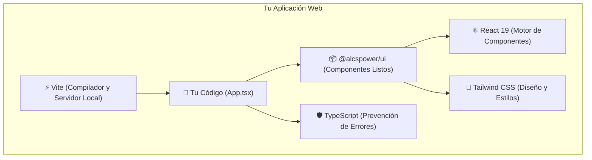

# 🟢 Módulo 00: Introducción Conceptual al Desarrollo Web Moderno

> **"Aprender a programar no es memorizar códigos secretos: es aprender a descomponer grandes problemas en piezas pequeñas y ordenadas."**

¡Bienvenido al primer paso de tu viaje! Antes de abrir terminales, descargar programas o preocuparnos por escribir código, necesitamos entender el panorama general. Muchas personas abandonan la programación en su primera semana no porque sea difícil, sino porque intentan memorizar palabras extrañas sin entender qué representan en el mundo real.

En este capítulo vamos a derribar mitos y construir una base sólida usando comparaciones que ya conoces de tu vida cotidiana. Al terminar este módulo, cuando escuches palabras como "React", "Componente", "TypeScript" o "Estado", sabrás exactamente qué significan y para qué sirven.

---

## 📚 Lo que aprenderás en este capítulo

1. **¿Qué es realmente programar?** La analogía de la receta de cocina.
2. **¿Qué es React y por qué revolucionó internet?** La analogía de los bloques de LEGO.
3. **¿Qué es un Componente?** Tu primera pieza digital explicada línea por línea.
4. **¿Qué es `@alcspower/ui`?** La caja de LEGOs de lujo que ya viene armada para ti.
5. **¿Qué es TypeScript?** Nuestro cinturón de seguridad contra equivocaciones tontas.
6. **¿Qué es Tailwind CSS?** Un guardarropa listo para vestir a tus componentes con estilo.
7. **El Gran Glosario de Términos (10 Conceptos Clave)** que todo programador usa a diario.
8. **Mapa visual de nuestro stack tecnológico**.

---

## 🍳 1. ¿Qué es programar? (La Receta de Cocina)

Imagina que quieres enseñarle a alguien a preparar un pastel de chocolate casero. Si esa persona jamás ha cocinado, no puedes simplemente decirle *"Haz un pastel"*, porque se quedará paralizada sin saber qué hacer.

Tienes que darle una **receta**:
1. Abre el refrigerador y toma 3 huevos y 1 taza de leche.
2. Rompe los huevos en un tazón hondo.
3. Agrega 2 tazas de harina tamizada y 1 taza de azúcar.
4. Bate en círculos durante 5 minutos hasta que no queden grumos.
5. Vierte la mezcla en un molde engrasado.
6. Mételo al horno a 180°C durante 40 minutos.

**Programar es exactamente eso**: escribir una serie de instrucciones claras, ordenadas y sin ambigüedades para que una computadora las ejecute al pie de la letra.

Las computadoras son increíblemente veloces calculando cosas, pero tienen una peculiaridad: **son extremadamente literales y no tienen sentido común**. Si en la receta olvidas decir *"rompe los cascarones de los huevos antes de batir"*, la computadora batirá los huevos enteros con cascarón y todo. 

Por eso, cuando programamos, nuestro trabajo no es "hacer magia", sino pensar con calma: *¿Qué paso va primero? ¿Qué paso va después? ¿Qué pasa si el usuario hace clic aquí?*

---

## 🧱 2. ¿Qué es React? (La analogía de los bloques de LEGO)

Hace muchos años, las páginas de internet se construían como si fueran gigantescas esculturas de yeso talladas en una sola pieza. Si querías cambiar el color de un botón o el nombre de un usuario en la barra de navegación, tenías que recargar la página entera desde cero. Era lento, pesado y agotador de mantener.

En 2013, ingenieros de Meta (Facebook) presentaron **React** con una idea revolucionaria:

> **"En lugar de esculpir una página entera como una sola mole, vamos a construirla uniendo piezas modulares e independientes, igual que bloques de LEGO."**

Piensa en una casa hecha de LEGO:
- Tienes ladrillos pequeños para las paredes.
- Tienes piezas especiales para las ventanas.
- Tienes una pieza articulada para la puerta.
- Tienes una placa especial para el tejado.

Si un día decides que la puerta azul se vería mejor roja, no destruyes la casa completa: simplemente quitas la puerta azul y encajas la roja. El resto de la casa permanece intacto.

Eso es exactamente **React**: una biblioteca de JavaScript que te permite crear interfaces web dividiendo tu pantalla en pequeñas piezas independientes e intercambiables llamadas **Componentes**.

---

## 🧩 3. ¿Qué es un Componente? (Tu primera pieza de código)

En React, un **componente** es simplemente una función que describe cómo debe verse una parte de tu pantalla. 

Por ejemplo, imagina un botón sencillo que dice "¡Hola!". En React se escribe así:

```tsx
// Un componente en React es como una fábrica de botones
function BotonSaludar() {
  // Aquí devolvemos el aspecto visual de nuestro botón
  return (
    <button className="mi-boton-azul">
      ¡Hola, bienvenido a mi aplicación!
    </button>
  );
}

// Para usar este componente en otra parte de tu pantalla,
// simplemente escribes su nombre con etiquetas como si fuera HTML:
// <BotonSaludar />
```

### Analicemos este código línea por línea:

1. `function BotonSaludar()`: Declaramos una función llamada `BotonSaludar`. Por convención en React, **todos los componentes deben empezar con letra mayúscula**. Si le llamas `botonSaludar` con minúscula, React creerá que es una etiqueta común y corriente de HTML.
2. `return (...)`: La función "regresa" o "devuelve" la estructura visual que queremos pintar en la pantalla.
3. `<button ...>...</button>`: Esto se parece mucho a HTML, pero en el mundo de React se llama **JSX** (JavaScript XML). Te permite escribir etiquetas visuales directamente dentro de tu código JavaScript.
4. `<BotonSaludar />`: Una vez creado tu componente, puedes reusarlo 1, 10 o 100 veces en cualquier lugar de tu aplicación simplemente escribiendo `<BotonSaludar />`. ¡Si necesitas cambiar el texto del botón, lo cambias en un solo archivo y se actualizará automáticamente en todas partes!

---

## 📦 4. ¿Qué es `@alcspower/ui`? (La caja de LEGOs prefabricada)

Si bien tú podrías crear cada botón, cada menú y cada ventana emergente desde cero usando HTML y CSS básico, la realidad es que toma cientos de horas de trabajo hacer que un botón:
- Tenga esquinas redondeadas modernas y colores armoniosos.
- Cambie de color suavemente cuando pasas el ratón por encima (hover).
- Muestre un círculo giratorio animado cuando está cargando información (`isLoading`).
- Sea accesible para personas con debilidad visual o que usan lectores de pantalla.
- Funcione perfectamente con el teclado (por ejemplo, al presionar la tecla `Enter` o `Espacio`).

Aquí es donde entra **`@alcspower/ui`**.

> **`@alcspower/ui` es una biblioteca de componentes de interfaz de usuario (UI Design System)** creada específicamente para que tú no tengas que reinventar la rueda.

Es como comprar una caja de LEGOs donde los botones (`Button`), las tarjetas (`Card`), los menús desplegables (`Select`), los avatares (`Avatar`) y las etiquetas (`Badge`) ya vienen diseñados por diseñadores profesionales con los más altos estándares de accesibilidad y belleza.

Tú solo tienes que importarlos y ensamblarlos para crear tu propia aplicación:

```tsx
// En vez de diseñar un botón complejo desde cero...
// ¡Solo lo importas de la biblioteca y lo usas con una línea!
import { Button } from '@alcspower/ui';

export function MiPantalla() {
  return (
    <Button variant="primary" size="lg">
      Guardar Contacto
    </Button>
  );
}
```

¿Viste qué sencillo y limpio se ve? Eso es el poder de `@alcspower/ui`.

---

## 🛡️ 5. ¿Qué es TypeScript? (El copiloto y red de seguridad)

Originalmente, el lenguaje de la web es **JavaScript**. JavaScript es un lenguaje muy flexible y poderoso, pero a veces es *demasiado permisivo*. 

Imagina que tienes un componente `Button` que acepta un tamaño: `"sm"` (pequeño), `"md"` (mediano) o `"lg"` (grande).
Si estás usando JavaScript tradicional y cometes un error de dedo escribiendo:

```jsx
<Button size="enorme">Haz clic</Button>
```

JavaScript no te dirá nada. Se quedará callado, cargará la página y el botón aparecerá deforme, roto o sin estilos, y tendrás que perder media hora averiguando qué salió mal.

**TypeScript es JavaScript con superpoderes de comprobación de tipos**. Funciona como un copiloto experto sentado a tu lado mientras escribes código:

1. Mientras escribes `<Button size="`, tu editor (VS Code) te abrirá un menú desplegable mostrándote exactamente las únicas opciones válidas: `"sm"`, `"md"`, `"lg"`, `"icon"`, etc.
2. Si cometes un error de tipeo como `size="enorme"`, TypeScript subrayará la palabra en **rojo brillante de inmediato** y te dirá:
   > *"Error: El valor 'enorme' no es válido. ¿Quizás quisiste decir 'lg'?"*

TypeScript no te deja equivocarte antes de que tu código llegue a internet. Te da confianza total mientras desarrollas.

---

## 🎨 6. ¿Qué es Tailwind CSS? (Tu guardarropa de estilos utilitarios)

Toda página web necesita tres cosas fundamentales:
1. **HTML (La estructura)**: Los huesos y las paredes (un botón, un párrafo, una imagen).
2. **CSS (El estilo visual)**: La pintura, la ropa y el maquillaje (colores, sombras, márgenes, bordes redondos).
3. **JavaScript / React (El comportamiento)**: El cerebro y los músculos (qué pasa cuando hago clic, qué pasa cuando escribo).

En el desarrollo web tradicional, escribir CSS requería tener un archivo separado lleno de reglas complejas. **Tailwind CSS** cambió todo eso inventando el concepto de "clases utilitarias".

Imagina que en lugar de ir con un sastre a coser un pantalón desde cero cada mañana, tienes un armario lleno de prendas ya listas que puedes combinar:
- `p-4` significa *"ponle un relleno (padding) de 16 píxeles a los lados"*.
- `bg-blue-500` significa *"pinta el fondo de color azul medio"*.
- `rounded-lg` significa *"haz que las cuatro esquinas sean redondeadas"*.
- `flex items-center` significa *"pon los elementos uno al lado del otro y céntralos verticalmente"*.

Nuestra biblioteca `@alcspower/ui` utiliza Tailwind CSS v4 internamente para que todos los componentes sean ultraligeros, elegantes y compatibles entre sí.

---

## 📖 7. El Gran Glosario de Términos (10 Conceptos Clave)

Cada profesión tiene sus palabras especiales. Los médicos hablan de "presión sistólica" y los mecánicos de "árbol de levas". En programación web, estos son los 10 términos que escucharás todo el tiempo:

| # | Término | ¿Qué significa en lenguaje humano? | Ejemplo sencillo |
| :-: | :--- | :--- | :--- |
| **1** | **Componente** | Una pieza visual y reutilizable de la interfaz (un botón, una barra, una tarjeta). | `function MiBoton() { ... }` |
| **2** | **Prop** (Propiedad) | Parámetros o configuraciones que le pasas a un componente para cambiar su aspecto o contenido. | `<Badge variant="success">` (`variant` es la prop) |
| **3** | **Estado (State)** | La memoria de un componente. Información que puede cambiar con el tiempo y que hace que la pantalla se vuelva a pintar. | Si el usuario hace clic en "Modo Oscuro", el estado cambia de falso a verdadero. |
| **4** | **Hook** | Funciones especiales de React (casi siempre empiezan con `use...`) que le permiten a tu componente tener memoria o hacer acciones especiales. | `const [contador, setContador] = useState(0);` |
| **5** | **JSX** | La sintaxis que parece HTML pero vive dentro de tus archivos de JavaScript o TypeScript (`.tsx`). | `return <h1>Hola Mundo</h1>;` |
| **6** | **NPM / pnpm** | Tienda / Gestor de paquetes. Una gigantesca biblioteca en la nube donde programadores comparten piezas de código para que otros las instalen gratis. | `pnpm add @alcspower/ui` |
| **7** | **Import** | La instrucción para traer una pieza de código o componente desde otro archivo o biblioteca a tu archivo actual. | `import { Button } from '@alcspower/ui';` |
| **8** | **Export** | La instrucción para poner tu componente disponible para que otros archivos puedan usarlo con `import`. | `export function MiTarjeta() { ... }` |
| **9** | **Función** | Un bloque de código con un nombre que realiza una tarea específica cuando se lo pides. | `function sumar(a, b) { return a + b; }` |
| **10**| **Variable** | Una caja con etiqueta donde guardas un dato (un texto, un número, una lista) para usarlo más adelante. | `const nombreUsuario = "Carlos";` |

---

## 🗺️ 8. Resumen Visual del Stack Tecnológico

Para que te quede 100% claro cómo encajan todas las piezas que usaremos en este instructivo, observa el siguiente esquema de capas:



### ¿Cómo interactúan entre sí?
1. **Vite** arranca un servidor de prueba ultraveloz en tu computadora y te da un enlace local (como `http://localhost:5173`) para ver tu app en el navegador.
2. Tú escribes tu interfaz en **`App.tsx`**.
3. Traes componentes hermosos de **`@alcspower/ui`** (`Button`, `Card`, `Badge`).
4. **TypeScript** vigila que no cometas faltas ortográficas en tus props.
5. **Tailwind** se asegura de que todo tenga márgenes, colores y sombras espectaculares.
6. **React** se encarga de reaccionar de inmediato cuando el usuario hace clic o escribe en el teclado.

---

## ✅ Resumen del Módulo 00

En este módulo aprendiste:
- Que **programar** es solo dar instrucciones paso a paso como una receta de cocina.
- Que **React** funciona como bloques de LEGO: divides la pantalla en piezas reutilizables llamadas componentes.
- Que **`@alcspower/ui`** es tu caja de componentes prediseñados y accesibles para que construyas interfaces hermosas en minutos.
- Que **TypeScript** es tu red de seguridad contra errores tipográficos y de lógica.
- Que **Tailwind CSS** te permite dar estilos limpios y modernos sin escribir CSS complicado.

¡Felicitaciones! Ya tienes las bases teóricas y el vocabulario necesario. En el siguiente capítulo nos ensuciaremos las manos instalando Node.js, pnpm y creando tu primer proyecto real.

---

| [← Volver al Índice Principal](README.md) | [Módulo 01: Instalación y Entorno →](01-instalacion.md) |
| :--- | ---: |
