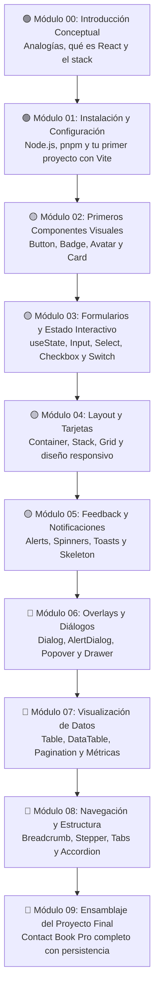

# 🚀 ¡Bienvenido al Instructivo de @alcspower/ui!

> **"Cualquiera puede aprender a programar si cuenta con las explicaciones correctas y las herramientas adecuadas."**

¡Hola! Qué alegría tenerte aquí. Si nunca antes has escrito una línea de código, si abrir una terminal negra con texto verde te parece algo salido de una película de ciencia ficción, o si simplemente sientes que la tecnología avanza demasiado rápido y quieres aprender a crear tus propias aplicaciones web: **este lugar es para ti**.

No asumimos que eres un genio de las matemáticas. No asumimos que sabes qué es un "servidor" ni qué significa "compilar". Este instructivo fue diseñado con una sola meta en mente: **llevarte de la mano, paso a pasito, con un lenguaje cálido y cotidiano, para que descubras la magia de construir interfaces de usuario profesionales**.

---

## 🎯 ¿Qué vamos a construir juntos?

Para que el aprendizaje no sea aburrido ni puramente teórico, a lo largo de este instructivo construiremos una aplicación real, moderna y visualmente atractiva:

### 📱 **Nuestra "Agenda de Contactos Inteligente"**

Imagina una aplicación web donde podrás:
1. **Ver tarjetas de contacto hermosas** con foto de perfil (Avatar), nombre, estado de actividad con insignias de color (Badge) y botones de acción.
2. **Agregar nuevos contactos** a través de un formulario interactivo con campos de texto (Input), selectores desplegables (Select), interruptores de favoritos (Switch) y casillas de verificación (Checkbox).
3. **Organizar la información** mediante pestañas (Tabs), divisores limpios (Separator) y ventanas de diálogo emergentes.
4. **Ver cómo tus datos cobran vida**: cuando escribes un nombre o activas un interruptor, la pantalla reacciona al instante sin recargarse.

Y lo mejor de todo: no tendrás que diseñar cada botón o campo desde cero dibujando píxeles o batallando con hojas de estilo complejas. Utilizaremos **`@alcspower/ui`**, una biblioteca que ya tiene construidas las piezas fundamentales listas para que tú las unas, igual que si estuvieras armando un set de bloques de LEGO.

---

## 🧩 ¿Qué componentes vas a dominar?

Aprenderás a usar con total confianza los siguientes bloques de construcción oficiales de `@alcspower/ui`:

- 🔘 **`Button`**: Botones elegantes con estados de carga ("Guardando..."), diferentes variantes (primario, secundario, destructivo) y tamaños.
- 🏷️ **`Badge`**: Pequeñas etiquetas de estado de colores (éxito, advertencia, información) ideales para mostrar si un contacto está activo o pendiente.
- 👤 **`Avatar`**: Círculos para imágenes de perfil con respaldo inteligente de iniciales si la foto falla al cargar.
- 🗂️ **`Card`**: Contenedores estructurados con cabecera, título, cuerpo y pie de página para agrupar información limpia y ordenada.
- ✍️ **`Input`**: Cajas de texto modernas preparadas para detectar errores visuales (borde rojo) o validaciones exitosas (borde verde).
- 📋 **`Label` y `Field`**: Etiquetas accesibles y contenedores que organizan tus formularios de forma semántica y profesional.
- 🔽 **`Select`**: Menús desplegables fluidos y accesibles para elegir categorías o departamentos sin complicaciones.
- ☑️ **`Checkbox`**: Casillas de verificación para opciones de sí/no o términos y condiciones.
- 🎚️ **`Switch`**: Interruptores deslizantes estilo teléfono móvil para activar o desactivar configuraciones como "Favorito".
- 📑 **`Tabs`**: Pestañas de navegación para alternar entre diferentes vistas (por ejemplo: "Todos", "Favoritos", "Trabajo").
- ➖ **`Separator`**: Líneas sutiles de división horizontales o verticales para dar aire y jerarquía a tu diseño.

---

## 🗺️ Mapa de Ruta del Aprendizaje

A continuación puedes ver el recorrido que haremos juntos. Cada estación está pensada para que te sientas seguro antes de dar el siguiente paso:

---

## 📚 Índice de Módulos

| Módulo | Tema Principal | Dificultad | Tiempo Estimado | Enlace |
| :---: | :--- | :---: | :---: | :---: |
| **00** | **Introducción: Perdiendo el miedo a programar** Analogías cotidianas, qué es un componente, qué es React y glosario para principiantes. | 🟢 Fácil | 20 minutos | [Comenzar Módulo 00 →](00-introduccion.md) |
| **01** | **Instalación y tu Primer Proyecto** Instalando Node.js, pnpm, creando tu app con Vite y configurando `@alcspower/ui`. | 🟢 Fácil | 30 minutos | [Comenzar Módulo 01 →](01-instalacion.md) |
| **02** | **Primer Componente: Tarjeta de Perfil** Aprende a usar Button, Badge, Avatar y Card para crear tarjetas atractivas. | 🟡 Media | 45 minutos | [Comenzar Módulo 02 →](02-primer-componente.md) |
| **03** | **Interactividad y Formularios** ¿Qué es el estado (`useState`)? Captura datos con Input, Select, Checkbox y Switch. | 🟡 Media | 60 minutos | [Comenzar Módulo 03 →](03-formularios.md) |
| **04** | **Layouts y Tarjetas** Estructura tus páginas con Container, Stack, Grid y composiciones responsivas de tarjetas. | 🟡 Media | 45 minutos | [Comenzar Módulo 04 →](04-layout-y-cards.md) |
| **05** | **Feedback y Notificaciones** Comunícate con el usuario mediante Alert, Spinner, Toasts, Skeleton y EmptyState. | 🟡 Media | 50 minutos | [Comenzar Módulo 05 →](05-feedback.md) |
| **06** | **Overlays y Diálogos Emergentes** Ventanas modales accesibles con Dialog, AlertDialog, Popover, Sheet y Tooltip. | 🔴 Avanzada | 60 minutos | [Comenzar Módulo 06 →](06-overlays.md) |
| **07** | **Visualización de Datos y Tablas** Tablas profesionales con Table, DataTable integrada con TanStack Table y Pagination. | 🔴 Avanzada | 75 minutos | [Comenzar Módulo 07 →](07-datos.md) |
| **08** | **Navegación y Flujos de Usuario** Guía la experiencia con Breadcrumbs, Stepper, Tabs y acordeones expansibles. | 🔴 Avanzada | 50 minutos | [Comenzar Módulo 08 →](08-navegacion.md) |
| **09** | **Proyecto Final: Contact Book Pro** Integra todos los módulos en una aplicación real, moderna y accesible lista para producción. | 🚀 Proyecto | 90 minutos | [Comenzar Módulo 09 →](09-proyecto-final.md) |

---

## ⚙️ ¿Qué necesitas antes de empezar?

No necesitas una computadora gamer superpotente ni pagar licencias caras de software. Todo lo que usaremos es **completamente gratuito y de código abierto**:

1. **Una computadora con Windows, Mac o Linux**.
2. **Ganas de aprender y un poco de curiosidad**.
3. **Un navegador web moderno** (Google Chrome, Microsoft Edge, Mozilla Firefox o Brave).
4. **Un editor de texto**: Te recomendamos encarecidamente instalar [Visual Studio Code (VS Code)](https://code.visualstudio.com/), que es el editor estándar de la industria.
5. **Node.js y pnpm**: No te preocupes por instalarlos ahora mismo; en el **Módulo 01** te guiaremos paso a paso con capturas y comandos exactos para descargarlos e instalarlos en 5 minutos.

---

## 💡 Filosofía de este Instructivo: Recuerda esto siempre

> [!TIP]
> 1. **Los errores no rompen la computadora**: Si escribes algo mal o ves letras rojas en la terminal, respira profundo. No has roto nada. Un error en programación es simplemente un mensaje amistoso de la computadora diciéndote: *"Oye, aquí no entendí qué quisiste decir, revisa esta línea"*.
> 2. **Copiar y experimentar es bienvenido**: Te recomendamos escribir el código con tus propias manos en vez de solo copiar y pegar, porque así se entrena la memoria de tus dedos. Pero si te cansas, copia el ejemplo, cámbiale los colores, cambia los textos y observa qué pasa.
> 3. **Ve a tu propio ritmo**: No hay prisa. Si un concepto como el "estado" te toma dos lecturas para hacer clic, es completamente normal. Todos los ingenieros de software pasamos exactamente por esa misma etapa.

---

¿Listo para iniciar esta aventura? Da el primer paso y descubre de qué se trata todo esto:

👉 **[Ir al Módulo 00: Introducción Conceptual →](00-introduccion.md)**
